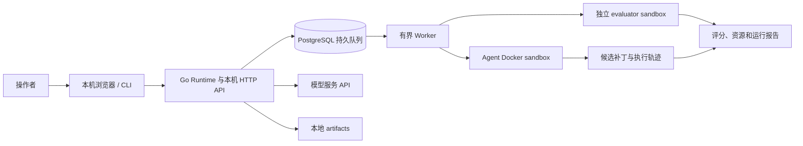

# AgentEval Runtime

[](https://github.com/jensen-Zeng/agent-eval-runtime/actions/workflows/go.yml) · [MIT License](LICENSE) · [English overview](docs/README.en.md)

AgentEval Runtime 1.4.0 是一个用 Go 编写的本机 Agent 执行与评测平台，支持登录、项目成员与按项目隔离的任务和用量管理。它将 Agent 任务放入受限的 Linux 容器，在独立评测环境中运行可信评分，并记录任务结果、执行轨迹、资源和可复核证据。

当前提供命令行、HTTP 队列服务和嵌入式中文网页。确定性 Scripted Agent 可在没有模型 Key 时运行；真实模型实验需自行配置 OpenAI-compatible 服务，并可能产生费用。

## 能力与边界

- Go 代码修复任务，附带三个可直接演示的题目：`go-parser-001`、`go-unique-002`、`go-range-003`。
- Harbor `T3-RL-v1.0` 受限子集：独立 Agent/verifier 镜像、`/app` 工作区、程序化连续评分和 submission 归档；通过 CLI 本机导入，重启服务后可在网页实验台选择。
- Docker sandbox、独立可信评测、超时和资源限制、轨迹与 JSON 报告。
- PostgreSQL 持久队列、有界 worker pool、取消、重启恢复与资源对账。
- 冻结任务输入的实验矩阵、多模型重复运行、恢复未完成实验、JSON/CSV 汇总和证据导出。
- 登录后的网页工作台按项目管理成员、数据集版本、实验、队列任务和用量；Go 程序内嵌前端资源，不需要 Node.js 或 npm。

运行任务使用 Linux amd64 Docker 容器。任务后端目前包括 Go 代码任务和 Harbor `T3-RL-v1.0` 子集；不代表支持任意语言或全部 Harbor 格式。Harbor 原始题包通过 CLI 导入，本版网页只选择已登记任务。控制端源码与构建支持 Windows 和 Linux；Linux 宿主端到端验证仍在推进。服务支持可信操作者在本机协作，并以项目成员权限隔离数据；它不是公网托管多租户服务，也不提供独立虚拟机隔离。

## 架构



模型 Key 由控制端提供，不传入 Agent 容器。评测在新建的容器中使用平台登记的 evaluator 和任务基线。

## 依赖

- Go 1.27.1。
- Docker Desktop 的 Linux Engine（Windows）或 Linux Docker Engine；需要 Docker Compose。
- 首次准备 sandbox 镜像及拉取 PostgreSQL 镜像需要网络。运行任务与评测的容器默认断网。
- 网页队列服务使用仓库提供的 PostgreSQL 17 Compose 配置；单次 CLI 演示不需要 PostgreSQL。

Docker daemon 必须处于 Linux 容器模式，并支持项目配置的 CPU、内存、swap 和 PID 限额。

## 快速演示：不需要模型 Key

这两个脚本会构建 Runtime、准备 sandbox 镜像、检查 Docker，再运行 `go-parser-001` 的确定性 Scripted 修复，并把结果写到 `artifacts/`。它们不启动 PostgreSQL，也不调用模型服务。

Windows PowerShell：

```powershell
.\scripts\demo.ps1
```

Linux：

```bash
bash ./scripts/demo.sh
```

首次运行会下载或构建所需依赖镜像；请先确认 Docker Linux Engine 正在运行。

## Windows 本机服务和网页

全新克隆后，先初始化数据库与 sandbox 镜像。此命令会构建 Runtime、启动 PostgreSQL、准备镜像并以前台方式启动服务：

```powershell
git clone https://github.com/jensen-Zeng/agent-eval-runtime.git
cd agent-eval-runtime
.\scripts\start.ps1 -ConfigFile configs/local.json
```

首次启动时按提示设置 PostgreSQL 密码。以后复用同一 Docker 卷时必须输入相同密码。保持该 PowerShell 窗口运行，然后打开 <http://127.0.0.1:8787/>。首次进入时创建唯一的初始管理员账号；登录后创建项目与成员，再在项目中登记数据集版本和实验。详细权限与配额流程见[项目管理指南](docs/PROJECTS.md)。Scripted 实验和已登记的 baseline 脚本都无需 API Key。

初始化过 sandbox 镜像后，可以双击仓库根目录的 `打开控制台.cmd`，或运行 `scripts/start-ui.ps1`。这两个网页启动入口会跳过镜像准备，因此要求镜像已先准备好；新克隆第一次启动请用上面的 `start.ps1`。

Linux 上可用以下命令启动本机队列服务；它会启动 PostgreSQL、准备 sandbox 镜像并以前台方式运行 Runtime：

```bash
bash ./scripts/start.sh
```

服务默认绑定 loopback。首次启动需要在网页完成管理员账号设置。按 `Ctrl+C` 停止 Runtime；PostgreSQL 容器及其数据卷会保留，后续启动继续使用原密码。

## 配置模型

网页启动后，在“连接设置”填写 OpenAI-compatible Endpoint、模型名和 API Key。网页可将 Key 加密保存在本机 `configs/ui/keyvault.json`；首次设置需要至少 12 个字符的主密码。Runtime 重启后需重新解锁。Key 不保存在浏览器或实验方案里。

也可以在启动服务的终端设置 `OPENAI_API_KEY` 和 `OPENAI_MODEL`，再启动 Runtime。不要把 Key 写入配置文件、题包、命令行参数或提交记录。只有需要真实模型评测时才配置 Key；模型调用可能产生费用。

## 项目实验流程

v1.4 的服务实验必须先选择项目和数据集版本，再在网页中提交。Owner 管理成员、已授权任务的数据集版本和项目限额；Executor 可提交、查看和取消实验；Reader 只读。所有项目 API 都要求当前用户属于目标项目，管理员也必须先加入项目。每个数据集最多 200 个任务，每个实验最多展开 500 个 task × variant × repeat。详细认证、版本化、幂等和配额规则见[项目管理指南](docs/PROJECTS.md)。

提交实验会在数据库事务中建立完整任务组并预占当日额度。预留额度在任务到达终态前保持 `reserved`：排队任务取消会释放；已运行任务完成、取消或被恢复流程终结后转为 `used`。队列、运行记录、事件和用量均按项目授权。

可信操作者仍可用 `runtime run` 直接运行单个任务，也可运行仓库的 `scripts/demo.ps1` 或 `scripts/demo.sh` 演示脚本；这些本机流程不走项目服务配额。旧 `runtime experiment`、`submit` 和 `batch` 客户端使用未分项目的 `/v1/runs` API，不适用于 v1.4 服务。旧 API 的 GET 和写请求都已关闭。
Harbor 题包的兼容范围、静态检查、本地镜像导入、资源覆盖、评分结果与证据说明见 [Harbor 接入指南](docs/HARBOR.md)。导入后需重启 Runtime；网页不直接导入原始题包。Harbor 的图像工具支持 PNG/JPEG 和 GIF 第 0–31 帧；视频/音频没有原生多模态消息接口，可在容器内用 `exec` 调用可用工具处理。

## 目录

```text
cmd/runtime/             CLI、队列服务和网页控制台
internal/                 Agent、任务、调度、存储与 Docker sandbox
internal/webui/assets/    嵌入 Runtime 的网页资源
tasks/fixtures/            可见任务源码与测试
evaluators/                平台可信评测材料
configs/local.json         本机通用配置
examples/                  通用数据集清单示例
docs/                      使用指南、设计记录和执行计划
artifacts/                 本地运行、实验与导出结果
```

## 安全边界

任务容器使用非 root 用户、只读根文件系统、断网、丢弃 Linux capabilities、no-new-privileges、seccomp、资源限制和临时文件系统。宿主源码目录、Docker socket、数据库凭据和模型 Key 不挂入 Agent 容器。可信 evaluator 单独运行，补丁和测试结果会在运行记录中保留。

容器仍与宿主共享 Linux 内核；Docker daemon 和本机操作者属于信任边界。网页与 API 仅供本机使用，不要暴露到公网或用于不可信的多租户代码执行。评分器和镜像也必须经过审核。

## 后续工作

当前版本仍需积累真实模型调用的质量与成本证据，扩大并冻结可复核任务集，并完成更多 Linux 主机端到端验收。多语言运行时、远程多机 worker、公网租户管理和更强恶意评分器隔离都需要独立设计与验证。

## 文档

- [命令行与配置参考](docs/CLI_REFERENCE.md)
- [网页控制台指南](docs/WEB_UI.md)
- [登录、项目、角色与配额指南](docs/PROJECTS.md)
- [v1.4 项目服务验收记录](docs/PROJECTS_ACCEPTANCE.md)
- [数据集适配与实验指南](docs/DATASETS.md)
- [Harbor T3-RL-v1.0 接入指南](docs/HARBOR.md)
- [v1.0 安全与性能边界](docs/V1.0_RELEASE.md)
- [项目执行计划](docs/EXECUTION_PLAN.md)
- [架构决策记录](docs/decisions/0001-v01-boundaries.md)
- [通用数据集清单示例](examples/dataset-manifest.json)

## 许可证与发布内容

平台源码、文档和三个自带演示任务采用 [MIT 许可证](LICENSE)。第三方依赖遵循各自许可证，见 [第三方与任务数据说明](THIRD_PARTY_NOTICES.md)。本机导入题包、私有评分材料、API Key、执行产物和历史验收日志不随仓库发布。

参与开发请阅读 [贡献指南](CONTRIBUTING.md)；漏洞报告请阅读 [安全说明](SECURITY.md)。版本记录见 [CHANGELOG](CHANGELOG.md)。
