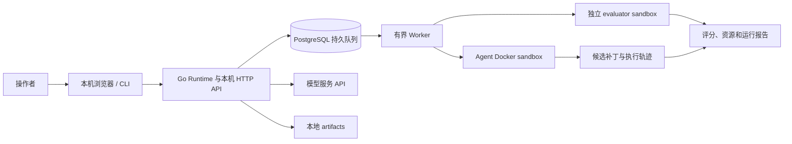

# AgentEval Runtime

[](https://github.com/jensen-Zeng/agent-eval-runtime/actions/workflows/go.yml) · [MIT License](LICENSE) · [English overview](docs/README.en.md)

AgentEval Runtime 1.2.0 是一个用 Go 编写的本机 Agent 执行与评测平台。它把代码修复任务放进受限的 Linux 容器，收集 Agent 生成的补丁，再在独立评测环境里运行可信测试。平台面向本机开发与实验，重点记录任务结果、执行轨迹、资源和可复核证据。

当前提供命令行、HTTP 队列服务和嵌入式中文网页。确定性 Scripted Agent 可在没有模型 Key 时运行；真实模型实验需自行配置 OpenAI-compatible 服务，并可能产生费用。

## 能力与边界

- Go 代码修复任务，附带三个可直接演示的题目：`go-parser-001`、`go-unique-002`、`go-range-003`。
- Docker sandbox、独立可信评测、超时和资源限制、轨迹与 JSON 报告。
- PostgreSQL 持久队列、有界 worker pool、取消、重启恢复与资源对账。
- 冻结任务输入的实验矩阵、多模型重复运行、恢复未完成实验、JSON/CSV 汇总和证据导出。
- 本机网页用于配置模型连接、组织实验和查看结果；Go 程序内嵌前端资源，不需要 Node.js 或 npm。

运行任务使用 Linux amd64 Docker 容器。控制端源码与构建支持 Windows 和 Linux；Linux 宿主端到端验证仍在推进。源码任务目前以 Go 为主；任务清单可以描述其他格式，但这不代表平台已支持对应语言的执行和评分。项目面向可信的本机操作者，不提供公网多租户服务或独立虚拟机隔离。

## 架构



模型 Key 由控制端提供，不传入 Agent 容器。评测在新建的容器中使用平台登记的 evaluator 和任务基线。

## 依赖

- Go 1.27.1。
- Docker Desktop 的 Linux Engine（Windows）或 Linux Docker Engine；需要 Docker Compose。
- 首次准备 sandbox 镜像及拉取 PostgreSQL 镜像需要网络。运行任务与评测的容器默认断网。
- 网页队列服务使用仓库提供的 PostgreSQL 17 Compose 配置；单次 CLI 演示不需要 PostgreSQL。

Docker daemon 必须处于 Linux 容器模式，并支持项目配置的 CPU、内存、swap 和 PID 限额。

## 快速演示：不需要模型 Key

这两个脚本会构建 Runtime、准备 sandbox 镜像、检查 Docker，再运行 `go-parser-001` 的确定性 Scripted 修复，并把结果写到 `artifacts/`。它们不启动 PostgreSQL，也不调用模型服务。

Windows PowerShell：

```powershell
.\scripts\demo.ps1
```

Linux：

```bash
bash ./scripts/demo.sh
```

首次运行会下载或构建所需依赖镜像；请先确认 Docker Linux Engine 正在运行。

## Windows 队列服务和网页

全新克隆后，先初始化数据库与 sandbox 镜像。此命令会构建 Runtime、启动 PostgreSQL、准备镜像并以前台方式启动服务：

```powershell
git clone https://github.com/jensen-Zeng/agent-eval-runtime.git
cd agent-eval-runtime
.\scripts\start.ps1 -ConfigFile configs/local.json
```

首次启动时按提示设置 PostgreSQL 密码。以后复用同一 Docker 卷时必须输入相同密码。保持该 PowerShell 窗口运行，然后打开 <http://127.0.0.1:8787/>。Scripted 实验和已登记的 baseline 脚本都无需 API Key。

初始化过 sandbox 镜像后，可以双击仓库根目录的 `打开控制台.cmd`，或运行 `scripts/start-ui.ps1`。这两个网页启动入口会跳过镜像准备，因此要求镜像已先准备好；新克隆第一次启动请用上面的 `start.ps1`。

Linux 上可用以下命令启动本机队列服务；它会启动 PostgreSQL、准备 sandbox 镜像并以前台方式运行 Runtime：

```bash
bash ./scripts/start.sh
```

服务默认绑定 loopback。按 `Ctrl+C` 停止 Runtime；PostgreSQL 容器及其数据卷会保留，后续启动继续使用原密码。

## 配置模型

网页启动后，在“连接设置”填写 OpenAI-compatible Endpoint、模型名和 API Key。网页可将 Key 加密保存在本机 `configs/ui/keyvault.json`；首次设置需要至少 12 个字符的主密码。Runtime 重启后需重新解锁。Key 不保存在浏览器或实验方案里。

也可以在启动服务的终端设置 `OPENAI_API_KEY` 和 `OPENAI_MODEL`，再启动 Runtime。不要把 Key 写入配置文件、题包、命令行参数或提交记录。只有需要真实模型评测时才配置 Key；模型调用可能产生费用。

## 实验流程

1. 在实验台选择已经登记的 Go 任务，设置模型和重复次数。只有题目登记了 `baseline` 脚本时，才能在网页选择该 baseline；自带 `go-*` fixture 的无 Key Scripted 示例见下面的 CLI 矩阵。
2. 启动实验。每个任务、Agent 配置和重复次数会建立独立 job；结果包括评分、耗时、资源数据和执行事件。
3. 在运行记录查看结果、恢复未完成的实验，或导出 JSON/CSV 和证据包。

命令行实验使用一个 JSON 矩阵文件。以下例子只使用仓库自带任务：

```json
{
  "schema_version": 1,
  "name": "parser-scripted-success",
  "tasks": ["go-parser-001"],
  "variants": [
    {"agent": "scripted", "script": "success"}
  ],
  "repeats": 2
}
```

保存为 `examples/parser-scripted.json` 后，在队列服务运行时执行：

```powershell
.\bin\runtime.exe experiment --file examples/parser-scripted.json --output artifacts/experiments/parser-scripted.json --wait
```

中断后使用相同矩阵和输出文件，并加 `--resume` 收集原实验结果。要重新执行并产生新的 jobs，应创建新的实验输出文件。数据集导入和依赖镜像准备流程见数据集指南；通用清单示例仅供按自己的数据目录修改，不能直接当成可运行题包。

## 目录

```text
cmd/runtime/             CLI、队列服务和网页控制台
internal/                 Agent、任务、调度、存储与 Docker sandbox
internal/webui/assets/    嵌入 Runtime 的网页资源
tasks/fixtures/            可见任务源码与测试
evaluators/                平台可信评测材料
configs/local.json         本机通用配置
examples/                  通用数据集清单示例
docs/                      使用指南、设计记录和执行计划
artifacts/                 本地运行、实验与导出结果
```

## 安全边界

任务容器使用非 root 用户、只读根文件系统、断网、丢弃 Linux capabilities、no-new-privileges、seccomp、资源限制和临时文件系统。宿主源码目录、Docker socket、数据库凭据和模型 Key 不挂入 Agent 容器。可信 evaluator 单独运行，补丁和测试结果会在运行记录中保留。

容器仍与宿主共享 Linux 内核；Docker daemon 和本机操作者属于信任边界。网页与 API 仅供本机使用，不要暴露到公网或用于不可信的多租户代码执行。评分器和镜像也必须经过审核。

## 后续工作

当前版本仍需积累真实模型调用的质量与成本证据，扩大并冻结可复核任务集，并完成更多 Linux 主机端到端验收。多语言运行时、远程多机 worker、公网租户管理和更强恶意评分器隔离都需要独立设计与验证。

## 文档

- [命令行与配置参考](docs/CLI_REFERENCE.md)
- [网页控制台指南](docs/WEB_UI.md)
- [数据集适配与实验指南](docs/DATASETS.md)
- [v1.0 安全与性能边界](docs/V1.0_RELEASE.md)
- [项目执行计划](docs/EXECUTION_PLAN.md)
- [架构决策记录](docs/decisions/0001-v01-boundaries.md)
- [通用数据集清单示例](examples/dataset-manifest.json)

## 许可证与发布内容

平台源码、文档和三个自带演示任务采用 [MIT 许可证](LICENSE)。第三方依赖遵循各自许可证，见 [第三方与任务数据说明](THIRD_PARTY_NOTICES.md)。本机导入题包、私有评分材料、API Key、执行产物和历史验收日志不随仓库发布。

参与开发请阅读 [贡献指南](CONTRIBUTING.md)；漏洞报告请阅读 [安全说明](SECURITY.md)。版本记录见 [CHANGELOG](CHANGELOG.md)。
