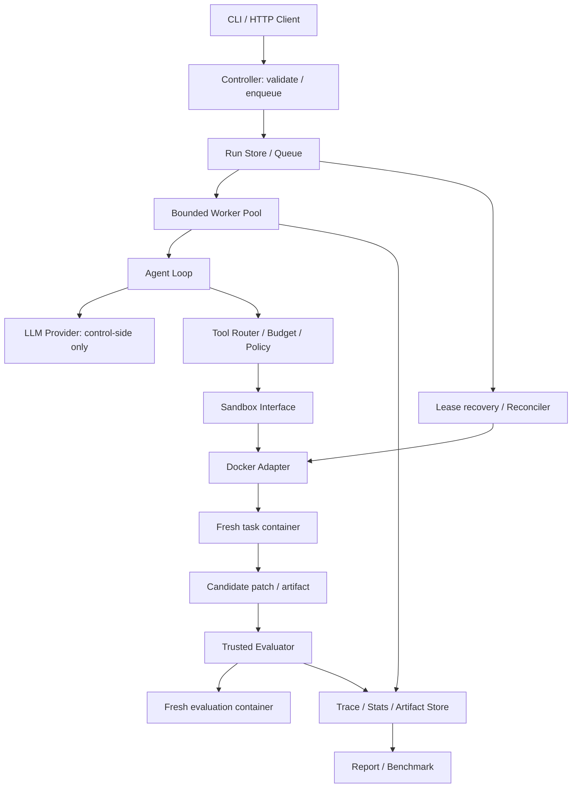

> 当前公开版本为 v1.2.0；以下保留历次执行计划及状态，后续版本状态覆盖早期未完成描述。首次使用请看 [项目首页](../README.md)。本机历史验收日志、作业原包和私人评分材料不随仓库发布。

# Go Agent Evaluation Sandbox / Agent Runtime 项目执行计划

> 当前交付版本：1.2.0（2026-10-06）。最新进度见第 21 节；[网页使用指南](WEB_UI.md)与运行验收（本机历史记录，不随仓库发布）已更新。

> 文档版本：v0.2；基准日期：2026-10-05（Asia/Shanghai）。
> 项目暂定名：AgentEval Runtime；目录名：`sandbox`。
> 本文保留完整目标与实施规划，并同步记录当前已实现内容和验收边界；早期状态在第 17.2 节，当前交付状态以第 19–21 节为准。
> 周计划按个人每周投入 12–18 小时、已有基本编程经验估算；验收通过比日历进度优先。

## 1. 项目目的与最终成果

做一个用 Go 实现的 Agent 执行与评测平台：用户提交代码修复任务，平台创建独立环境，Agent 在其中读写文件、修改代码、运行命令，平台再在可信评测环境中验证结果，并记录执行过程、资源使用和失败原因。

项目的核心产物不是聊天界面，而是可以回答以下问题的工程系统：

1. 一次 Agent 任务能否在限制内完成？
2. 修改是否真正通过目标测试、且没有破坏既有功能？
3. 成功花了多少时间、CPU、内存、模型调用和 token？
4. 哪一步失败，原因是模型能力、环境错误还是平台故障？
5. 同样的任务和补丁，别人能否重新评测并核对结果？
6. 多任务同时运行、worker 崩溃或服务重启后，任务和资源能否正确收敛？

### 1.1 面向的用户与使用场景

| 用户 | 使用场景 | 需要的结果 |
| --- | --- | --- |
| Agent 开发者 | 比较模型、提示词、工具策略 | 固定任务集上的成功率、成本、失败分布 |
| 后端/基础设施开发者 | 验证并发、隔离、资源治理与恢复 | 故障注入结果、压力测试与可追踪状态 |
| 面试评审 | 查看项目的技术深度与个人贡献 | 可运行演示、清晰设计、真实实验数据 |
| 项目作者 | 持续优化策略或运行时 | 从提交任务到报告的完整反馈闭环 |

### 1.2 与普通“Go 调 API + Docker exec”的区别

| 层次 | 必须拿出的证据 |
| --- | --- |
| 执行能力 | 环境生命周期、stdout/stderr、退出码、文件修改结果 |
| 自动评测 | 独立 evaluator、可信测试、标准化 verdict |
| 并发与资源治理 | 有界队列、worker pool、真实终止超时进程、限额生效检查 |
| 可观测性 | trace、指标定义、失败归因、可查询 artifact |
| 可复现与可靠性 | 镜像/任务/补丁哈希、状态持久化、租约、恢复与清理 |

校招价值取决于实现质量和证据，不能由功能数量或星级保证。优先做一条可靠主链路，再增加功能。

### 1.3 最终交付清单

- 一套 Go 源码、模块依赖锁定与可执行程序。
- Windows 开发说明与 Linux/Docker 运行说明。
- CLI，以及后续 HTTP API；先用 CLI 完成验收。
- Docker Sandbox 实现与可替换的运行时接口。
- 一套自建、可离线评测的代码修复任务集及 trusted evaluator。
- 至少一种真实 LLM Agent 与一种确定性 Scripted Agent。
- 并发调度、超时取消、持久状态与故障恢复。
- 每次运行的日志、补丁、trace、资源摘要和评测结果。
- 固定协议的 benchmark 报告、故障注入报告与演示脚本。
- README、架构说明、关键设计决策、局限与后续计划。

## 2. 当前进度与事实边界

| 项目项 | 当前状态 | 下一步 |
| --- | --- | --- |
| Go 环境 | Go 1.27.1 windows/amd64 已安装，PATH 与编译/运行/测试验证完成 | M0 已完成 |
| Git 与 Go 项目 | Git、module 与 CLI 主模块已建立 | M0 已完成 |
| Docker Engine | Docker Engine 29.7.2，Linux Engine 就绪；真实 sandbox 接口测试通过 | M0 已完成 |
| v0.1 主链路 | 已完成并验收：Agent、sandbox、补丁收集、独立可信 evaluator、预算、报告、轨迹与资源摘要 | v0.1 交付完成；真实模型 pilot 单独开展 |
| 任务与故障覆盖 | 3 个独立 fixture；各缺陷基线失败、参考修复成功；共 15 项注册测试。解析任务另覆盖篡改、超时、OOM | M1 已完成；继续扩充开发任务集 |
| LLM | OpenAI 已选；工具协议已通过本地 mock + 实际 Docker 完整链路；当前没有 API key 或 model 配置 | 配置可用凭据和模型后开展真实模型 pilot；暂不声称真实能力或成本结果 |
| v0.2 实现交付 | worker pool、PostgreSQL 持久队列、loopback API/error contract、CLI client、20-job batch manifest、取消/drain、单 owner recovery 与基础查询/状态指标代码已交付 | WINDOWS_RUNTIME_ACCEPTED：Windows Go 测试、vet、Docker/mock 集成及 A01–A12 运行验收通过；Linux 仅交叉编译，主机运行未测 |
| v0.2 验收矩阵 | Windows amd64 A01–A12 均已通过，包含 20-job batch、W=2 上限、取消、重启恢复、错误契约和 batch 中断恢复 | 结果与原始证据见 v0.2 运行验收记录（本机历史记录，不随仓库发布）；复现步骤见 验收矩阵（本机历史记录，不随仓库发布） |

进度计算用“已通过验收的工作项 / 已确定工作项”，不以目录存在、代码行数或 README 宣称功能计算。Docker/sandbox 验收、九次最终 CLI 运行与实际 run ID 见 v0.1 验证记录（本机历史记录，不随仓库发布），v0.1 历史验收保持不变。v0.2 已完成 Windows amd64 Go 测试、vet、Docker/mock 集成和 A01–A12 单机运行验收，详细证据见 v0.2 运行验收记录（本机历史记录，不随仓库发布）。Linux 主机运行、真实付费模型调用与模型能力/成本 benchmark 尚未执行；mock 协议验证不等于真实模型实验。M4 仍部分完成，M5 尚未实现，M6 的单实例恢复有本地证据但不包含分布式 lease/fencing。Windows/Linux amd64 编译结果均成功，但 Linux 交叉编译不代表 Linux runtime 验收。

## 3. 范围、版本与非目标

### 3.1 分三个可交付版本

| 版本 | 内容 | 可展示的完成条件 |
| --- | --- | --- |
| v0.1 / MVP | 单任务 Docker sandbox + Scripted/LLM Agent + 可信评测 + 基本预算 + JSON 报告 | 修复一个缺陷并由独立测试确认；失败任务也有明确结果 |
| v0.2 / 工程版 | worker pool + 持久队列 + API/error contract + CLI client + trace/状态指标 + batch client/sample | 20 个 Scripted job 有界并发，取消可观察，queued 重启恢复；人工验收有 job/run/artifact 证据 |
| v1.0 / 展示版 | 冻结 benchmark/实验 manifest + 补丁独立复评 + lease/heartbeat/fencing + fault injection/reconciler + 发布文档演示 | 第三方复评补丁；故障注入和固定实验有可核查证据 |

安全的基础限额、生命周期清理和可信评测从 MVP 开始实现，不能等到最后一版补。

### 3.2 第一阶段固定边界

- 控制器可以在 Windows 开发运行；任务与 evaluator 首先只支持 Linux amd64 容器。
- 初始任务语言只选 Go；任务环境与控制器实现语言是两个不同维度。
- 单机 Docker Engine、一个可信操作者、一个主服务；模块化单体即可。
- 每个 attempt 使用独立 sandbox；不同任务不共用可写 workspace。
- 首期使用自建小任务集，后续再评估公开 benchmark 的适配成本。
- LLM 请求由可信控制器发起；任务容器默认无外网、没有 provider key。
- 初始 agent 工具：列目录、读文件、写文件/应用补丁、执行命令、提交结果。
- 真实 Agent 暂不运行多个协作子 Agent，先把单 Agent 的观测与评测做好。

### 3.3 暂不纳入首期

Kubernetes、多集群、多租户公网服务、用户自选 privileged 容器、任意 Docker 参数、Windows/macOS 原生任务环境、GPU、复杂 Web UI、向量数据库、自动提示词优化、商用计费、完整 SWE-bench-Live 集成。第二种语言、第二种运行时也不阻塞 v1.0；可作为后续独立里程碑。

### 3.4 参考项目的准确使用方式

SWE-bench-Live 提供每任务专用 Docker 镜像，值得参考的是可执行环境与可复现评测的组织方式。查阅的官方资料主要聚焦 Python；不据此宣称它已经覆盖多语言和多 OS。多语言可单独参考 Multi-SWE-bench，多 OS 列为本项目未来能力目标。[SWE-bench-Live 论文](https://arxiv.org/abs/2505.23419)、[官方仓库](https://github.com/SWE-bench-Live/SWE-bench-Live)。

## 4. 开发环境与 Go 安装计划

### 4.1 推荐环境

| 组件 | 选择 | 理由与约束 |
| --- | --- | --- |
| 宿主 | Windows x64 + PowerShell | 保持当前使用环境，脚本显式 UTF-8 |
| Go | 官方稳定版 1.27.1，用户目录安装 | 不需要修改机器级 PATH；先验证再开发 |
| Docker | Docker Desktop 的 Linux Engine | 执行 Linux sandbox，与 Windows 宿主区分 |
| 编辑器 | 当前编辑器；可选 VS Code + Go 扩展 | 不强制安装额外 IDE |
| Git | 已在 AgentEval Runtime 项目内初始化 | 不把上层文档目录纳入仓库 |
| 状态存储 | MVP 文件；M3 PostgreSQL | 文件不承担多 worker 事务调度；数据库容器后置 |
| 监控 | MVP JSON 摘要；M4 Prometheus endpoint | Grafana 可选，不影响核心报告 |

官方下载列表在 2026-10-05 返回 Go 1.27.1 为稳定版。安装文件为 `go1.27.1.windows-amd64.zip`，期望 SHA-256：

```text
a3911b5e0e1b1053f25ed0675f4c1c6aad1e2bfcf253df2b9be4caabd2edd95d
```

下载与校验依据：[Go 官方下载 API](https://go.dev/dl/?mode=json)、[Go 安装说明](https://go.dev/doc/install)。版本只表示本次选择；未来升级要更新环境锁定并重跑基线，不能悄悄跟随 latest。

### 4.2 安装及配置步骤（本次已完成并验证）

1. 在实际用户上下文检查 PATH 与常见安装路径，避免重复安装。沙箱执行账号的 profile 不能代替实际用户 profile。
2. 下载官方 Windows amd64 ZIP，计算 SHA-256 并与官方记录比较；不匹配就停止安装。
3. 安装到 `%LOCALAPPDATA%\Programs\Go`；已有安装目录不直接覆盖。
4. 向用户级 PATH 加入安装目录的 `bin` 与 `%USERPROFILE%\go\bin`，保留原 PATH，不修改机器级 PATH。
5. 不手动设置 `GOROOT`；默认 GOPATH 可由 `go env GOPATH` 确认。Go modules 项目不必放在 GOPATH 内。
6. 不默认替换 GOPROXY / GOSUMDB；网络不通时再检查官方源、代理和证书，不静默关闭校验。
7. 新终端执行版本和环境验证，再编译、运行、测试一个仅用标准库的小程序。
8. 安装记录保存到 `.setup/go-installation-result.json`；烟雾测试只验证工具链，不代表业务代码完成。

验证命令（PowerShell，新终端）：

```powershell
go version
go env GOOS GOARCH GOROOT GOPATH GOPROXY GOSUMDB
Get-Command go
docker version
docker info --format '{{.OSType}}'
```

验收：Go 输出 `go1.27.1 windows/amd64`；标准库示例的 `go test`、`go build`、`go run` 成功。Docker 必须同时显示 client/server 信息，OSType 为 `linux`。只看到 CLI 版本不算 Docker 环境通过。

PATH 注册后，已运行的 Codex/IDE 进程可能仍继承旧环境；需要新终端，必要时重启应用。临时用完整 `go.exe` 路径可以验证安装，不等于新进程 PATH 已自动刷新。

### 4.3 Docker 连接与排障

Windows 控制器通过 Docker Engine API 管理 Linux 任务容器。官方资料说明 Windows 支持 named pipe；本项目已验证当前 Docker context 与 SDK 的真实 sandbox 接口，未来切换 daemon/context 时仍需重新验证，不能只假设固定端点可用。[Docker Desktop FAQ](https://docs.docker.com/desktop/troubleshoot-and-support/faqs/general/)、[Engine SDK](https://docs.docker.com/reference/api/engine/sdk/)。

| 现象 | 先检查什么 | 处理边界 |
| --- | --- | --- |
| named pipe 不存在 | Docker Desktop 是否运行、当前 context | 启动 Desktop 后再检查；不要改成裸 TCP |
| CLI 成功，Go SDK 连接失败 | DOCKER_HOST、context endpoint、API 协商 | 配置明确 endpoint；记录 API version |
| OSType 为 windows | 当前容器模式 | 切换 Linux containers 后重验 |
| 配置文件 Access denied | 当前执行账号是否为沙箱账号 | 在真实用户上下文复核，避免修改权限掩盖问题 |
| 镜像拉取失败 | 网络、认证、代理、磁盘 | 与 daemon 不可用、sandbox 代码错误分别归因 |
| WSL 后端异常 | Docker Desktop diagnostics / WSL 状态 | 按官方排障，环境问题不计 Agent 失败 |

本次安装未更改 Docker 权限或系统虚拟化设置。M0 和 v0.1 已通过真实 sandbox 验证；当前状态按 17.2 节追踪。

当前 Docker Engine 29.7.2 的 Linux Engine 已就绪；真实 sandbox 接口、OpenAI 模拟工具链及三项代码任务已通过验收。容器隔离、资源配置、结果与限制见 v0.1 验证记录（本机历史记录，不随仓库发布）。

### 4.4 容器化 Go 工具链作为备用路线

宿主 Go 为推荐路线。若机器环境受限，可用固定版本的官方 golang 镜像编译/测试。构建容器是可信开发工具，任务 sandbox 是不可信执行环境；两者的权限不可混用。

- 初次确认具体镜像标签存在并拉取，记录镜像 digest；正式实验禁止 latest。
- Linux 容器内 `go test ./...` 验证 Linux 路径。
- 如交叉编译 Windows 控制器，纯 Go 依赖可用 `GOOS=windows GOARCH=amd64`；Windows exe 在宿主运行，不能在 Linux 容器直接执行。
- 默认不采用需要 CGO 的控制器依赖；确需采用时单独建立 Windows 构建方案。
- 仅可信开发构建可以绑定项目源码；Agent 容器不绑定原始宿主项目目录。
- 不向任务容器挂载 Docker socket 或 named pipe。

参考：[Docker 官方 golang 镜像](https://hub.docker.com/_/golang)。

## 5. 系统架构与职责划分



### 5.1 模块职责

| 模块 | 负责 | 不应承担 |
| --- | --- | --- |
| task | 任务定义、版本、可见输入、trusted evaluator 引用 | 接受任务任意 Docker 权限 |
| controller | 校验、生成 run、查询、取消、健康检查 | 直接把用户输入拼进宿主 shell |
| scheduler | 有界排队、领取、租约、重试策略、并发限流 | 判定测试是否成功 |
| agent | 模型会话、工具请求、步数和 token 预算 | 掌握 daemon 连接、修改评分规则 |
| tools | 参数校验、路径约束、结果裁剪、错误标准化 | 执行宿主机器上的任务命令 |
| sandbox | Create / Exec / Files / Stats / Destroy | 绑定 LLM provider 或 benchmark |
| evaluator | 从干净基线应用补丁、运行可信测试、输出 verdict | 相信 Agent 自述或可变工作区的测试结果 |
| trace | 结构事件、顺序、阶段耗时、artifact 引用 | 无限制记录密钥、无限大输出 |
| benchmark | 实验清单、固定协议、统计、失败分类 | 混淆模型结果与基础设施故障 |
| recovery | 对账、失联 attempt 收敛、孤儿资源处理 | 删除无项目标记的 Docker 资源 |

### 5.2 技术取舍

Go 适合此项目的控制端：context、goroutine、channel、HTTP/JSON、可部署二进制和竞态检查都能直接服务于调度、取消与观测。首期使用标准库优先；Docker 使用官方 Go SDK，依赖版本在 M0 锁定。接口按实际调用边界建立，不为每个结构体预建复杂框架。

M1–M2 可将 run 元数据与结果写入独立 artifact 目录；M3 再迁移 PostgreSQL，通过事务和条件更新实现任务领取。首期不同时引入 Redis、Kafka 和多个微服务。文件落盘使用临时文件 + 原子替换；必要时按平台处理 fsync/rename 行为，不能假设 Windows 与 Linux 完全相同。

### 5.3 目录结构与后续模块

核心 v0.1 模块已建立；以下结构同时包含已实现路径与后续规划路径，不能据此推断每个模块都已交付。

```text
agent-eval-runtime/
  cmd/runtime/                  # 主程序，CLI / serve 子命令
  internal/config/
  internal/task/
  internal/agent/
  internal/tools/
  internal/sandbox/docker/
  internal/evaluator/
  internal/scheduler/
  internal/store/
  internal/trace/
  internal/metrics/
  internal/recovery/
  internal/report/
  api/                          # API/schema 与错误契约
  migrations/                   # M3 数据库迁移
  tasks/fixtures/               # 可见任务材料，不含隐藏答案
  evaluators/                   # 可信 harness；不复制给 Agent
  configs/                      # 示例配置，禁止真实密钥
  scripts/                      # PowerShell 开发脚本 / Linux CI 脚本
  deployments/                  # Dockerfile / Compose
  docs/EXECUTION_PLAN.md         # 当前文档
  docs/architecture.md
  docs/decisions/
  experiments/                  # 冻结的实验清单与可公开报告
  artifacts/                    # 默认 gitignore，按 run 隔离
  .setup/                       # 环境安装记录与 smoke，gitignore
  go.mod / go.sum
  README.md / .gitignore
```

隐藏测试不依赖“目录名称隐藏”保护：任务输入打包时明确排除它们，Agent 不能读取控制端文件。公开仓库里发布的 fixture 测试只能用于公开开发基线；正式保留集应另外保存且不用于调参。

### 5.4 CLI 与 HTTP API 的计划契约

CLI 已实现 `version`、`doctor`、`prepare`、`hash`、`run`、`get`、`serve` 与本地 HTTP client `submit/status/list/cancel/events/tasks/batch`。批次 manifest 与逐项 progress 用显式 `--output` 保存；batch 默认 deadline 10m，成功退出 0、任务失败 2、提交/IO/基础设施/deadline 错误 1。`runtime get` 接收 runner `run_id`；队列操作接收 `job_id`。省略 `--config` 时走内置 `Default()`，不会自动载入 `configs/local.json` 或 `.env`。

```text
runtime version
runtime doctor --config configs/local.json
runtime run --task tasks/fixtures/go-parser-001/task.json --agent scripted
runtime run --task tasks/fixtures/go-parser-001/task.json --agent llm --model <model>
runtime serve --config configs/local.json
runtime get <run_id>
runtime submit --url http://127.0.0.1:8787 --task-id go-parser-001 --agent scripted --idempotency-key KEY
runtime status --url http://127.0.0.1:8787 <job_id>
runtime list --url http://127.0.0.1:8787 --limit 20
runtime cancel --url http://127.0.0.1:8787 <job_id>
runtime events --url http://127.0.0.1:8787 --after-seq 0 --limit 100 <job_id>
runtime tasks --url http://127.0.0.1:8787
runtime batch --file examples/v0.2-batch.json --output artifacts/batches/run.json --wait --timeout 10m
```

Benchmark manifest/runner 与 patch reevaluation 是 M5/v1.0 计划功能；当前不是已实现的 CLI 命令。

| API（M3） | 行为 | 返回与错误 |
| --- | --- | --- |
| `POST /v1/runs` | 提交已注册 task 与 agent 配置；可用 Idempotency-Key | 新 job 202，复用 200；错误 400/409/429；成功响应字段 `id` 为持久 queue job ID |
| `GET /v1/runs/{job_id}` | 返回状态、当前 attempt、结果摘要与 artifact 引用 | 200；不存在 404 |
| `POST /v1/runs/{job_id}/cancel` | 请求取消；与终态提交按条件更新竞争 | 当前实现返回 HTTP 200 与更新后的 job；用户传 queue job ID |
| `GET /v1/runs/{job_id}/events` | 按 after_seq/limit 分页读取事件 | 200，序号和 next cursor；禁止无限响应 |
| `GET /healthz` | 控制器存活 | 200 时 JSON `status: healthy`；失败为 503 统一错误 envelope |
| `GET /readyz` | 服务是否可接单 | 200 时 JSON `status: ready`；失败为 503 统一错误 envelope，不返回依赖细节 |
| `GET /metrics` | 低基数平台指标 | 当前返回 job 状态、worker 与 draining gauges；完整资源统计仍属 M4 |

每个 API request handler 有 15 秒 deadline。普通 JSON 响应顶层带 `schema_version: 1` 与 `request_id`，响应头带 `X-Request-ID`；错误含 `code/message/retryable` 并保留 `error` 字段，可选 retry_after。metrics 是 Prometheus text，使用 request ID header。API 首期仅监听 `127.0.0.1`，不默认开放 LAN/Public；运行配置/请求只能引用可信注册的环境与 evaluator，不能上传 Docker 权限参数。artifact 下载若以后开放，必须通过注册 ID 解析，不能提供任意宿主路径下载。

## 6. 数据模型、任务契约与状态机

### 6.1 核心实体

| 实体 | 关键字段与约束 |
| --- | --- |
| TaskSpec | schema_version、task_id、task_revision、语言/目标 OS、源码基线哈希、prompt、输入 bundle 哈希、可信 evaluator 引用 |
| Policy | 由平台控制的镜像 allowlist、工具范围、资源预算上限、网络策略、artifact 限制；任务只可申请更低预算 |
| Run | run_id、task_revision、agent_config_hash、status、deadline、当前 attempt、created_at、finished_at、verdict |
| Attempt | attempt_id、run_id、owner、generation/fencing_token、lease_until、sandbox IDs、状态、失败类别、retry_reason |
| ToolCall | tool_call_id、step、工具名、裁剪参数、开始/结束、exit_code、reason、stdout/stderr artifact 引用 |
| EvalResult | evaluator_version/hash、patch_hash、目标/回归测试计数、日志、verdict、评测预算 |
| Artifact | run/attempt 归属、类型、相对路径、bytes、sha256、retention、是否截断/敏感 |
| Experiment | 固定 task 列表、agent/model/prompt/预算、重复次数、环境清单、原始 run 列表、汇总方法 |

标识符由平台生成或严格校验，不能直接把外部 task_id 拼成磁盘路径。数据库时间统一 UTC；报告可转换到 Asia/Shanghai。耗时用单调计时器，避免系统时钟调整影响预算。

### 6.2 可见任务示例

以下是计划 schema 示例，哈希/digest 是占位符，不能直接执行。镜像与 evaluator 来自平台管理的注册表；Agent 可见 payload 不包含 trusted 配置。

```yaml
schema_version: 1
task_id: go-parser-001
task_revision: 1
language: go
target: linux/amd64
source:
  bundle_ref: fixtures/go-parser-001/source.tar
  sha256: <verified-source-sha256>
prompt: 修复 ParseCount 在空输入与边界数字上的错误，保持已有行为。
environment_ref: go-fixture-v1
evaluator_ref: parser-evaluator-v1
requested_budget:
  run_wall_seconds: 600
  command_wall_seconds: 30
  cpu_cores: 1
  memory_mib: 512
  pids: 64
  max_steps: 20
  max_total_tokens: 30000
```

资源值是起始配置，不保证适配全部 Go 编译任务；M1 测量峰值后调校。更改限额会创建新的实验配置，不能继续当作同一 benchmark 条件。

### 6.3 Run 与 Attempt 状态

正常流转：

```text
QUEUED -> PREPARING -> RUNNING -> COLLECTING -> EVALUATING
       -> FINALIZING -> terminal
```

终态：`SUCCEEDED`、`FAILED`、`TIMED_OUT`、`CANCELED`、`INFRA_ERROR`。持久化前后必须定义明确的状态转换条件。

- `FAILED` 表示有效环境内候选补丁未解决任务，或 Agent 预算/行为失败；具体 reason 单独保存。
- `TIMED_OUT` 表示运行预算超时；reason 明确是 queue / prepare / command / agent / eval。
- `INFRA_ERROR` 表示 daemon、镜像、宿主故障或评测器异常；不伪装成“测试失败”。
- `FINALIZING` 中写入 artifact 与最终结果；cleanup 状态独立保存为 pending/succeeded/failed。
- 测试成功但清理失败可以保留评测成功，同时显示资源异常，不能吞掉清理告警。
- 重试建立新的 Attempt，不篡改旧 attempt；终态 Run 不重新打开，要复跑则新建 Run。
- 基础设施重试继承同一逻辑 Run 的总 deadline 和成本上限，不重新获得完整 600 秒；已没有剩余预算则结束为相应超时/基础设施结论。
- 取消是意图字段 `cancel_requested_at`；CAS 决定与完成结果的竞态，返回是否已生效或已经终态。

## 7. 功能需求与实现清单

P0 为 MVP 必需；P1 为工程版/展示版必需；P2 为后续增强。每项都要有行为与验收证据。

| ID | 优先级 | 功能 | 验收标准 | 阶段 |
| --- | --- | --- | --- | --- |
| ENV-01 | P0 | Go 安装与验证 | version / test / run / build 成功，PATH 记录明确 | M0 |
| ENV-02 | P0 | Docker readiness | daemon 可用、Linux 模式、受控容器可执行并清理 | M0 |
| TASK-01 | P0 | TaskSpec 校验 | schema、哈希、预算、环境/evaluator 引用不合法即拒绝 | M1 |
| SBX-01 | P0 | 独立 sandbox 生命周期 | create/start/exec/collect/destroy 完整，失败也进入清理 | M1 |
| SBX-02 | P0 | 命令执行 | argv/workdir/env 明确，区分 stdout/stderr 和退出码 | M1 |
| SBX-03 | P0 | 文件工具 | 读写/补丁只作用于 workspace；越界和超限拒绝 | M1 |
| SBX-04 | P0 | 最低隔离策略 | 无宿主目录/socket/key，非 root，cap drop，默认断网 | M1 |
| SBX-05 | P0 | 资源与超时 | CPU/memory/pids 配置可检查；超时后容器内进程真正停止 | M1 |
| AGT-01 | P0 | Scripted Agent | 不依赖模型可跑确定性修复/失败/超时路径 | M1 |
| EVAL-01 | P0 | 独立可信评测 | 干净基线 + candidate patch + trusted tests，篡改可见测试不能作弊 | M1 |
| RPT-01 | P0 | 单次 JSON 报告 | task/run/attempt/verdict/原因/耗时/patch/log 引用完整 | M1 |
| AGT-02 | P0 | LLM Agent loop | 一种 provider，结构化工具调用，20 步等预算有效 | M2 |
| AGT-03 | P0 | 模型调用治理 | 超时、受控重试、token 预算、无密钥泄露 | M2 |
| QUE-01 | P1 | worker pool | 并发不超过 W；满队列背压，无每请求无限 goroutine | M3 |
| QUE-02 | P1 | 持久队列/状态 | 数据库事务领取；重启恢复排队项，幂等提交不重复创建 | M3 |
| API-01 | P1 | 提交/查询/取消 | API 与 CLI 语义一致；错误有 code 和 request_id | M3 |
| TRACE-01 | P1 | 结构轨迹 | 工具、模型、状态、评测有顺序事件与 artifact 引用 | M4 |
| MET-01 | P1 | 资源和平台指标 | 缺失标记明确，CPU 时间不冒充墙钟，标签基数受控 | M4 |
| BENCH-01 | P1 | 固定任务集批跑 | manifest 冻结，脚本产出原始 run 与可复核汇总 | M5 |
| REPRO-01 | P1 | 补丁复评 | 固定 source/image/evaluator 可复评，哈希不符拒绝 | M5 |
| REC-01 | P1 | 租约与恢复 | worker 失联后 attempt 收敛；旧 owner 不覆盖新结果 | M6 |
| REC-02 | P1 | 资源对账清理 | 只清理本项目已确认失主资源；清理失败可见且重试 | M6 |
| DOC-01 | P1 | 交付文档与演示 | 新环境按 README 跑通；已实现/计划功能明确区分 | M6 |
| EXT-01 | P2 | 第二任务语言 | 共用 Run/Result schema，新增环境/evaluator adapter | 后续 |
| EXT-02 | P2 | 第二隔离后端 | gVisor/VM 等先做能力探测与契约测试 | 后续 |
| EXT-03 | P2 | UI / 分布式 workers | 核心 CLI/API 不依赖 UI；多机再补认证与分布式存储 | 后续 |

## 8. Sandbox 的具体执行设计

### 8.1 接口边界

建议接口能力包括 `Create`、`Exec`、`ReadFile`、`WriteFile`、`ApplyPatch`、`Snapshot/Diff`、`Stats`、`Destroy`、`Capabilities`。具体 Go 签名由 M1 第一次真实调用收敛；输入与结果不暴露 Docker 专有类型。Docker SDK 类型只存在 adapter 内。

ExecRequest 至少包含 argv、工作目录、允许的环境变量、timeout、输出上限。ExecResult 包含退出码及其是否已知、开始结束时间、stdout/stderr、truncated、超时/取消原因。不能把 transport error 当作 exit code 1。

### 8.2 生命周期

1. 验证可信任务注册、镜像 digest 与输入哈希，检查预算和磁盘余量。
2. 为 attempt 生成资源标签与独立 workspace；标签包含项目实例、run、attempt、generation。
3. 从固定 image 创建容器，上传经过验证的 source bundle，确认权限和 writable 路径。
4. 启动容器并探测就绪状态；禁止准备无限等待。
5. 工具调用经 policy/budget 后进入 sandbox；持续采集必要状态与资源样本。
6. Agent 完成或被预算终止，提取 candidate patch；保证收集阶段也有上限。
7. 销毁执行环境；评测使用新的环境与独立工作区。
8. 写入结果，清理所有归属资源；清理失败写状态并由 reconciler 处理。

所有阶段能处理“资源创建成功但数据库记录失败”等部分完成情况。资源名称预先由 run/attempt 派生并可对账，Create/Destroy 支持幂等收敛。

### 8.3 超时与取消必须终止实际进程

`context.WithTimeout` 取消 SDK 请求不等于 Docker exec 进程停止。MVP 采取简单策略：命令超时使本 attempt 中止，停止/kill 整个专属容器，再确认进程和容器不再运行；不继续使用可能存在后台进程的环境。

- 若未来支持单命令超时后继续 Agent，需实现进程组管理，并覆盖 fork/后台子进程测试。
- cancel 的清理使用独立、有限时长的 cleanup context，不能复用已经 canceled 的 run context。
- `defer cleanup` 处理正常返回，不能覆盖宿主断电、SIGKILL 和 daemon 不可达；这些靠持久状态和恢复处理。
- 队列等待、环境准备、Agent、单条命令、模型请求、评测和清理有各自预算，并受总 deadline 约束。
- MVP 默认排队 TTL 300 秒；从有效领取开始的总执行预算为 600 秒，包含 prepare/agent/collect/eval/finalize，不包含排队。阶段上限：prepare 120 秒、command 30 秒、model request 60 秒、collect 30 秒、eval 120 秒、finalize 15 秒；每阶段实际 timeout 取阶段上限与总 deadline 剩余时间的较小值。
- Agent 阶段为 collect/eval/finalize 预留最多 165 秒；进入 Agent 时以总 deadline 减去预留时间作为 Agent deadline，剩余时间不足则不启动下一模型/工具调用。模型响应重试也受同一 deadline 限制。
- deadline 到达立即停止执行，另用最多 30 秒 cleanup context 收敛资源；最终报告区分 execution timeout、finalization 失败和 cleanup 失败，不能因最后阶段未完成而伪造成功。

### 8.4 初始限制策略

| 项 | 初始策略 | 验证方式 / 限制 |
| --- | --- | --- |
| CPU | 每 attempt 1 core quota | Inspect 配置 + CPU 压测验证；不是预留独占核心 |
| 内存 | 初始 512 MiB，按 fixture 校准 | OOM fixture 与 daemon 状态；非 exit 137 单独判断 OOM |
| swap | 请求 memory-swap 与 memory 相同 | 能力检查确认；不支持就报告能力缺失 |
| 进程数 | 初始 64，编译任务可调整 | 受控进程压力 fixture，不做无限 fork |
| 身份 | 非 root；workdir 权限预置 | 容器 `id` 与文件写入检查 |
| 能力 | drop ALL，no-new-privileges | Inspect；保留默认 seccomp，按宿主报告 AppArmor 等支持 |
| 文件系统 | 根文件系统只读，workspace 和临时路径可写 | 编译 cache/tmp 路径显式设置；禁止敏感宿主挂载 |
| 网络 | runtime/eval 默认 none | 容器访问外网失败；依赖在可信 prepare 阶段预置 |
| 输出 | 单次工具返回 64 KiB；单 attempt 日志初始 10 MiB | 输出截断但持续排空流，避免子进程阻塞 |
| patch/input | 初始 1 MiB patch、50 MiB source bundle | 体积/文件数/路径校验，超限明确原因 |
| 磁盘 | 先磁盘阈值 + 输出/workspace 监测 | 普通 volume 无通用可移植硬配额；硬限额是后续 backend 能力 |

上表是本项目的设计目标，具体支持度由 M0/M1 验证。Docker 默认没有 CPU/内存限额，必须显式设置并检查宿主支持；配置“写成功”不等于限制“实际生效”。[Docker 资源限制](https://docs.docker.com/engine/containers/resource_constraints/)。

### 8.5 路径与输入安全

- 文件工具仅接受 workspace 内的路径；不能靠字符串前缀判断包含关系。
- 处理 `..`、绝对路径、Windows drive/UNC、符号链接、hardlink 与 TOCTOU；首期 fixture/source bundle 禁止链接、设备文件、FIFO 等特殊条目。
- tar 导入/导出校验条目总数、体积与路径；拒绝 zip/tar traversal，不直接解压到宿主敏感目录。
- 文件读写工具与任意 shell 执行的权限层次不同：允许 shell 后不能声称整个容器只有工作区文件可读。真正秘密与宿主文件必须根本不进入容器。
- trusted policy 控制镜像、挂载、环境变量和网络；外部 TaskSpec 不能覆写高权限 Docker 参数。
- patch 只允许本任务定义的代码路径；默认拒绝修改 evaluator、评分配置、平台脚本、特殊文件/链接和不支持的二进制补丁。
- task repository 的代码与测试执行本身也不可信；evaluator 容器同样需要限制，且不携带平台密钥。

## 9. Agent 与工具协议

### 9.1 首期工具

| 工具 | 输入 | 返回 | 约束 |
| --- | --- | --- | --- |
| list_files | relative path、depth | 文件条目 | 数量和深度上限 |
| read_file | relative path、range | UTF-8 文本/受控二进制提示 | 单次大小限制；不强制转换未知编码 |
| write_file | path、content | bytes/hash | 路径与文件尺寸校验 |
| apply_patch | 统一 diff | 成功/冲突细节 | 允许路径、体积与格式校验 |
| exec | argv、workdir、timeout | stdout/stderr、exit_code | 工具预算与容器边界；不在宿主执行 |
| finish | summary | 停止 Agent loop | 平台提取实际 patch，summary 不是评分依据 |

需要 shell 特性时显式使用容器中的 shell argv，例如 `['sh','-lc', '...']`；所有执行仍位于 sandbox。HTTP controller 不通过宿主 PowerShell 执行 Agent 命令。

### 9.2 Agent loop

```text
任务可见说明 + 工具 schema + 当前预算
  -> 请求模型
  -> 校验工具调用 JSON / tool_call_id
  -> 检查策略与剩余预算
  -> 执行 sandbox 工具
  -> 裁剪结果并记录 trace
  -> 追加 tool observation
  -> 下一步，直到 finish / budget / error / cancel
```

- M1 的 Scripted Agent 提供固定动作序列，用于排除模型随机性。
- M2 先适配一种 provider；Provider 接口将厂商的工具调用/usage 字段转换成内部结构。
- 模型名称、prompt hash、provider/API 配置版本与采样参数进入 manifest。
- 模型返回未知工具、非法参数或重复 tool_call_id 时按协议拒绝，受控反馈，计入步数。
- 若 API 不提供精确 token usage，字段标为 unknown/estimated；不得写成精确值。
- token 上限包含所有已知调用与重试；提供输出 token 上限并估算下一请求预算，最终 usage 校正。token 与金额预算分开配置。
- 超时/429/5xx 可受控退避，默认最多 2 次传输重试、受 run deadline 限制；每次都留事件，不能隐藏额外成本。
- 网络错误后无法知道 provider 是否已计费：记录 usage/cost uncertainty，不承诺请求 exactly-once。
- 限制上下文长度；工具长输出优先 artifact + 有限摘要，不能无限堆入对话。
- provider key 来自控制器配置/环境，不进 task bundle、模型可见工具环境或 trace。
- 不要求或记录模型私有推理链；trace 记录可见响应、动作、工具结果和状态即可。

## 10. 自动评测与任务集

### 10.1 为什么单独创建评测环境

Agent 可改代码、改可见测试、改工作区脚本，因此不能在可变工作区执行一次 `go test` 就判成功。正式评测流程：

1. 校验 task revision、原始基线 bundle hash、image digest、trusted evaluator hash。
2. 在全新 evaluator sandbox 重建干净源码基线。
3. 应用受限制的 candidate patch；记录实际 patch hash。
4. 注入平台保存的 trusted tests / harness，保持内容版本不变。
5. 执行 evaluator 注册的确定性命令，禁网、设置独立预算。
6. 收集退出码、结构测试结果和日志；将输入、补丁、harness 哈希写入报告。
7. 结束并清理 evaluator 容器。

Agent 的自述、可见测试输出、日志中写出的“PASS”都不能直接作为成功证据。目标测试和回归测试均由 trusted harness 统计。首期不以“代码与标准答案完全相同”作为成功标准。

### 10.2 Verdict 与 reason

| Verdict | 判定 |
| --- | --- |
| success | 有效候选 patch 通过全部目标与指定回归检查 |
| test_failure | 环境有效，但目标/回归测试未通过 |
| invalid_patch | 路径、格式、体积非法或不能应用于指定基线 |
| agent_budget_exhausted | 步数、token 或允许成本耗尽 |
| timeout | 明确阶段超时 |
| canceled | 有效取消已终止执行 |
| infra_error | daemon、依赖环境、评测器本身或宿主异常 |

编译失败通常属于有效任务失败；镜像缺失/daemon 中断属于基础设施错误。OOM 发生在有效任务程序上一般计入预算失败；宿主 OOM 或配置异常另分类，不能一概归模型失败。

### 10.3 任务集分阶段

| 规模 | 用途 | 样例 |
| --- | --- | --- |
| 3–5 个 fixture | 验证执行与评分系统，不做模型能力结论 | 正确补丁、错误补丁、篡改测试、超时、OOM |
| 10 个开发任务 | M2/M3 调试工具与提示词 | 边界条件、字符串处理、map/slice、文件解析 |
| 20–30 个冻结任务 | M5 可展示 benchmark | 按难度分层，包含真实小型仓库修复 |
| 公开 benchmark 子集 | 后续验证泛化 | 单独处理数据版本、许可、镜像与 harness 适配 |

每个正式任务必须有 prompt、固定基线、trusted 目标/回归测试、人工验证的参考补丁、环境定义和难度标签。参考补丁只是离线校验材料，不提供给 Agent。

任务纳入规则：原始基线的目标测试确实失败；参考补丁让目标与回归测试通过；预热后的离线环境多次结果一致；无法稳定复现的任务进入隔离区而非悄悄排除已失败 runs。公开数据记录来源与许可，公开报告说明样本规模和适用边界。

## 11. 并发调度、持久化与故障恢复

### 11.1 单机 worker pool

- 固定 W 个 worker，默认 W=2；通过资源探测与配置调整，不能仅以宿主 CPU 数决定。
- 队列容量初始 100；满队列返回明确错误与重试建议；不能无上限积压。
- P1 前使用内存队列，明示进程重启不恢复；M3 后用数据库任务表，不让 channel 充当持久队列。
- worker 领取一个逻辑 Run 的 Attempt；CPU/内存 slot 从准备到评测释放，确保同时运行的 Agent/eval 容器总量受控。
- 模型请求并发单独限流；W 个任务不等于 W 个无界 provider 请求。
- 队列截止时间与执行截止时间分开；取消排队项无需创建容器。
- 服务退出先停止接单，再限时 drain；超时则停止所属容器并保存中断结果。

### 11.2 数据库与幂等

建议表：tasks、runs、attempts、events、artifacts、experiments。schema migration 作为版本化交付物。

- 提交使用 idempotency_key + 请求体 hash；同 key 同 body 返回原 run，不同 body 返回冲突。
- 任务领取通过事务或条件更新保证当前有效 owner 唯一；默认 FIFO，可后续增加优先级。
- 状态更新检查当前状态、owner、generation；终态提交使用 CAS。
- artifact 保存先写入 attempt 专属 staging，再校验 hash，最后提交不可变引用；数据库不得指向未完成的半文件。
- 事件序号在 run/attempt 内单调；重试不能覆盖旧日志和旧 patch。
- 数据库暂不可用时停止新领取；不要继续运行无法续约且无法证明归属的旧任务。

### 11.3 租约与恢复策略

起始参数：heartbeat 5 秒、lease 30 秒、reconcile 10 秒；这些是可调策略，不是精确恢复 SLA。

1. worker 周期续约，续约失败后按有限窗口停止本 attempt，默认 fail closed。
2. lease 过期后恢复器核对 owner 与 generation，将旧 attempt 标成 lost/infra_error。
3. 对旧资源进行限时停止和归属确认；清理不确定时不在同一槽位盲目启动重试。
4. 如符合重试策略，创建 generation 更高的新 attempt。
5. 旧 worker 即便恢复，也不能更新新 attempt 或覆盖 run 终态；提交路径校验 fencing token。
6. Docker 资源 label 与持久记录定期对账，处理容器/volume/network 残留。

本项目提供 at-least-once attempt 执行与受控终态提交，不承诺物理执行 exactly-once。fencing 保护结果写入；不能单靠数据库 token 保证旧容器已经停止。模型调用重试也可能产生额外计费。

### 11.4 重试规则

| 失败 | 是否自动重试 | 原因 |
| --- | --- | --- |
| 正常测试失败、非法 patch、Agent 预算耗尽 | 否 | 属于一次 Agent 能力/行为结果 |
| 用户取消 | 否 | 尊重取消意图 |
| provider 短暂网络/429/5xx | 有限调用级重试 | 与完整 attempt 重试区分，计入成本和时间 |
| daemon 短暂不可用、worker 失联 | 最多 1 个额外 attempt（初始策略） | 新 sandbox，从基线重来，旧 attempt 不删除 |
| task/image/harness hash 不符 | 否，进入环境错误 | 重试不能修复不可信输入 |
| cleanup 失败 | 重试 cleanup，不重跑 Agent | 避免重复模型成本与错误统计 |

## 12. Trace、资源指标与报告

### 12.1 事件模型

事件至少包含 schema_version、run_id、attempt_id、event_seq、timestamp、phase、event_type、duration、reason，以及可选 tool_call_id/model_call_id/artifact_ref。MVP 可以 JSONL；M4 再加入查询与展示。为已写事件定义刷盘和恢复边界，不能声称所有进程崩溃前事件必然无损。

事件类型示例：run_queued、attempt_claimed、sandbox_created、agent_started、model_request/response、tool_started/finished、budget_exhausted、patch_collected、evaluation_started/finished、cleanup_failed、attempt_lost、run_finalized。

输出采用 bounded buffer + artifact 流式保存；到上限继续读取/丢弃并记录 truncation，防止 stdout 管道反向阻塞。敏感字段在持久化前裁剪/脱敏。对模型响应和 artifact 建立保留策略，避免长期无界增长。

### 12.2 指标定义

| 指标 | 口径 | 注意事项 |
| --- | --- | --- |
| queue_wait_ms | 入队到有效领取 | 排队与执行时间分开 |
| prepare_ms / agent_ms / eval_ms / cleanup_ms | 各阶段墙钟耗时 | 冷启动与镜像拉取另标记 |
| run_wall_ms | 从有效开始到结果 finalization | 不把 CPU 时间当墙钟 |
| container_cpu_seconds | 受控容器累计 CPU 使用量增量 | Agent 与 eval 分开；不包含模型服务端计算 |
| memory_peak_sampled_bytes | 周期采样最大值 | 可能漏掉短暂峰值；后端可用时另报告真实峰值 |
| network_rx/tx_bytes | 后端可提供的容器累计计数 | 默认断网；缺失写 null，非 0 |
| model_calls / tool_calls / steps | 实际发生次数 | 重试调用单独标记且计入总量 |
| input/output/total_tokens | provider usage，注明质量 | unknown/estimated/exact 分开 |
| estimated_cost | 按当次记录的计价版本计算 | 无价目/usage 就 unknown；不硬编码永不过期价格 |
| cleanup_lag / orphan_resources | 清理延迟与已确认孤儿数 | 与任务成功率分离 |
| trace_dropped / output_truncated | 丢弃和截断计数 | 保留可观测性质量信号 |

Docker stats 是容器级数据，不应写成每条命令的精确资源用量。采样周期初始 500 ms；小任务可能不足一个采样周期，显示缺失原因而不是编造数值。

Prometheus 的 label 使用 phase/status/reason 等低基数值；run_id、task_id 和用户输入留在 trace/DB，不作为无限增长的 metric label。

### 12.3 单次运行 artifact

```text
artifacts/<run_id>/
  manifest.json
  result.json
  attempts/<attempt_id>/
    trace.jsonl
    candidate.patch
    command-*.stdout.log / command-*.stderr.log
    evaluator.log / evaluation.json
    resource-samples.jsonl
```

结果包含失败 reason、环境/评测有效性、取消/清理状态、资源统计质量、所有 attempt 成本。MVP 生成 JSON + 简明 Markdown；HTML 报告后置。

## 13. Benchmark 与可复现性协议

### 13.1 实验配置必须冻结

固定 task IDs/revisions、source/image/evaluator hash、平台 commit、provider/model、prompt/tool schema hash、采样参数、预算、并发度、重复次数、时间与宿主/Engine 摘要。manifest 带 schema version 与 hash。

环境准备提前完成，task/eval 运行禁网。依赖缓存按可信版本维护，只读共享或每次复制；不复用 Agent 可以污染的可写缓存。

### 13.2 公平统计

设 N 为冻结任务数，R 为每任务预先确定的独立运行次数。首先报告 planned=N×R，以及 submitted/completed/canceled/infra_error。取消、缺失 run 和基础设施故障不能无说明从分母消失。

- 主展示指标：end-to-end success rate = solved logical runs / planned logical runs。
- 辅助指标：valid-evaluation success rate = solved logical runs / 有有效评测结论的 logical runs；同时报告有效评测覆盖率。
- 同一逻辑 run 的基础设施 attempt 重试不增加成功率分母，也不增加成功计数，但成本/时间汇总包含全部 attempts。
- 若报告一次尝试成功率，固定每任务只允许一次有效 Agent attempt；不能拿基础设施重试后最好结果冒充单次成功率。
- 如果报告 pass@k，明确 k、采样方式、独立性假设与估计方法；M5 默认不使用该指标。
- 延迟展示 median/p95 与样本数，并分别列成功/失败、冷/热准备。样本少时不做过强结论。
- 同时展示每成功任务成本、全部运行总成本、失败类别分布、并发吞吐。

### 13.3 实验矩阵

| 实验 | 固定什么 | 改变什么 | 用途 |
| --- | --- | --- | --- |
| A：平台确定性基线 | fixture、动作、资源 | 正常/超时/OOM/故障 | 证明平台行为正确 |
| B：Agent 策略比较 | 任务、模型、预算、并发 | prompt 或工具策略二选一 | 避免同时改多个变量 |
| C：并发容量 | 任务动作与环境 | W=1/2/4（容量允许时） | 排队、吞吐、资源与清理压力 |
| D：模型比较（可选） | 任务、prompt、工具、预算 | 模型 | 成功率/延迟/成本，预算允许再做 |

先用 5 个开发任务估算 token 与成本，再跑完整实验；未设置 provider key 时，所有平台测试仍可用 Scripted Agent 完成。正式实验默认建议 R=3，若经费不足可以 R=1，并在报告声明。

### 13.4 四种复现能力，分别说明

1. 环境复现：固定 source/image/toolchain/harness，重新建立同等环境。
2. 补丁复评：拿同一个 candidate patch 在干净环境重跑测试；这是 v1.0 必须实现的能力。
3. 轨迹检查：离线查看模型与工具事件，核对输入输出和原因。
4. Agent 重新运行：重新调用模型尝试任务；外部模型有随机性和服务更新，不保证相同补丁，即使 temperature=0。

完整动作重放可能有副作用、时间依赖和状态依赖，不等于 trace 查看，也不是首期默认提供的保证。

## 14. 里程碑与周执行计划

### 14.1 时间安排

以下按 M0 完成后开始计周；不是已承诺的完成日期。总估算 12 周、144–216 小时。Go 初学者或网络/环境准备复杂时，应预留额外 2–4 周。

| 节点 | 建议时间 | 具体交付 | 退出条件 |
| --- | --- | --- | --- |
| M0 环境与设计冻结 | 第 1 周 | Go/Docker 验证、独立仓库、模块、CLI 雏形、基础 ADR | 工具链编译测试成功；一条受控容器命令可清理 |
| M1 确定性执行评测闭环 | 第 2–3 周 | Docker adapter、工具、3–5 fixtures、Scripted Agent、evaluator、报告 | 修复、失败、作弊、超时/OOM 路径均有可信 verdict |
| M2 真实 LLM 闭环 | 第 4 周 | 一种 provider、Agent loop、预算与模型治理 | 开发任务成功/失败都可解释，key 不进入容器/日志 |
| M3 并发与持久状态 | 第 5–6 周 | worker pool、PostgreSQL、API、幂等、取消、drain | 20 个 Scripted jobs 无丢失；并发受控；重启恢复 queued；使用 batch progress manifest 与 job ID 留证 |
| M4 观测与资源证据 | 第 7 周 | 结构 trace、stats、metrics endpoint、聚合报告 | 给定 run 可定位失败步骤；指标口径与缺失值明确 |
| M5 benchmark 与复评 | 第 8–9 周 | 冻结任务集、manifest、实验脚本、报告、补丁复评 | 同一补丁独立复评一致；实验原始数据可核查 |
| M6 故障恢复与交付 | 第 10–12 周 | 租约/fencing、reconciler、故障注入、README、演示 | 故障后收敛，无静默丢失/越权清理；新环境可复现 |

关键路径：环境 → deterministic sandbox/eval → LLM → 调度持久化 → 观测 → 冻结实验 → 恢复/交付。早期建立资源 label、attempt ID 和状态字段，为 M6 留接口；不等最后才设计恢复模型。

### 14.2 每周工作包

| 周 | 主工作包 | 本周必须产出的证据 |
| --- | --- | --- |
| W1 | 安装 Go；检查 Docker；Git/模块；最小 CLI；确认 scope | 环境记录；运行说明；一条 Docker exec 与清理记录 |
| W2 | TaskSpec；Docker create/exec/files/destroy；预算；输入验证 | lifecycle integration tests；timeout 容器停止证明 |
| W3 | scripted actions；可信 evaluator；patch 收集；JSON result | 基线失败/参考补丁成功；篡改测试 fixture 仍失败 |
| W4 | provider adapter；工具 schema；LLM loop；token/step/call budget | 10 个开发任务探索日志；失败分类；v0.1 demo |
| W5 | 有界 pool；DB schema/migrations；run/attempt 状态 | 并发不超过 W；幂等和状态转换测试 |
| W6 | API；cancel；drain；持久 queued recovery | 20 run 批跑；取消和服务退出检查；v0.2 demo |
| W7 | trace schema；artifact；stats；metrics | 单 run 轨迹和资源报告；高输出截断与缺失样本处理 |
| W8 | 扩充任务；质量校验；冻结 holdout/manifest | 每任务 baseline/reference patch 校验结果 |
| W9 | benchmark；策略比较；并发实验；patch re-eval | 原始结果 + 汇总；实验成本与边界说明 |
| W10 | lease/heartbeat/fencing；restart recovery | worker kill 后恢复；旧 owner 终态写入被拒绝 |
| W11 | resource reconciler；daemon/DB 故障；磁盘/输出问题 | fault matrix；只清理项目资源；recovery time 数据 |
| W12 | 文档；CI；演示；发布打包与最终验收 | 新环境 walkthrough；v1.0 tag；未完成项与限制清单 |

### 14.3 里程碑演示脚本

- M1：提交缺陷任务 → Scripted Agent 读代码/改代码 → 展示 diff → 独立评测 success → 展示超时任务实际停止与清理。
- M2：真实模型修复任务 → 查看模型/工具轨迹 → 展示一个成功和一个失败，并解释预算。
- M3：20 任务排队、W=2 并发 → 取消队列/运行任务 → 重启服务 → 查询保留状态。
- M5：用同一 manifest 跑两种策略 → 报告成功率、耗时、token、失败分布 → 单独复评一个补丁。
- M6：kill worker / 暂停 daemon 连接 → 旧 attempt 失联 → 清理并按策略重试 → 旧 owner 不能覆盖 → 无孤儿资源。

演示可以选确定性 fixture 保证平台行为可重复；真实模型演示单独说明随机性。所有终端输出与报告来自真实运行，不手填数字。

## 15. 测试、故障注入与验收

### 15.1 必要测试层级

| 层级 | 覆盖内容 | 运行频率 |
| --- | --- | --- |
| 单元 | TaskSpec、预算、状态转换、统计口径、路径/patch 校验 | 每次相关代码修改 |
| 契约 | fake 与 Docker adapter 的共同语义；能力缺失 | 接口变化时 |
| Docker 集成 | lifecycle、stdout/stderr、退出码、timeout、文件、限制/清理 | sandbox/eval 修改时；需要 daemon |
| 端到端 | scripted success/failure/tamper/cancel | 每个里程碑和发布 |
| 并发/竞态 | pool、领取、lease、重复提交、cancel/finalize | M3/M6；支持的平台跑 race |
| 故障注入 | worker/服务/daemon/DB/artifact 写入故障 | M6 固定矩阵 |
| benchmark | 固定配置的真实 Agent 评测 | 策略版本稳定后；非每次 commit |

不为代码行数而补测试；测试验证外部行为、资源收敛与关键不变量。Go race detector 需要相应平台/工具链支持；Linux CI/开发容器可提供该环境，Windows 未配置 C 编译器时不把 race 未运行写成已通过。

### 15.2 故障矩阵

| 场景 | 预期结果 | 需要留下的证据 |
| --- | --- | --- |
| 命令无限循环 / 后台子进程 | timeout 后停止整容器，attempt 不继续 | inspect/停止时间/无运行进程 |
| 容器受控内存超限 | 记录有效 OOM 证据与预算失败 | Docker 状态 + reason，非仅 137 |
| stdout 大量输出 | bounded 日志、truncated、进程不阻塞 | artifact 大小、丢弃计数 |
| Agent 改可见测试/评分文件 | trusted evaluation 不被绕过 | 原始测试 hash、复建评测结果 |
| 两任务写同名文件 | 各自工作区互不影响 | workspace/volume IDs、文件内容 |
| worker 突然退出 | lease 过期、旧 attempt 收敛、有限重试 | 状态/事件/generation/资源清理 |
| 旧 worker 恢复提交 | CAS/fencing 拒绝旧终态写入 | 冲突日志与最终唯一有效结果 |
| daemon 暂不可用 | 不无限等待、不把连接错误归测试失败 | phase/reason/重试次数 |
| DB 不可用 | 不新领取、无法续约后停止执行 | 停止事件/恢复对账 |
| artifact 写入失败/磁盘不足 | 明确 infra error 或 artifact incomplete | 缺失引用不冒充有效完整结果 |
| cleanup API 失败 | cleanup_pending/failed，reconciler 重试 | orphan 状态与清理延迟 |
| 提交重试 / cancel 与完成竞争 | 幂等 run；单个终态有一致语义 | API 回应与数据库状态 |
| 平台服务重启 | queued 恢复；running 通过 lease 对账 | 重启前后状态清单 |

高压力 fixture 只在限定 CPU/memory/pids 与低并发下运行，不用无边界 fork bomb；磁盘故障优先用受控配额/故障注入，不填满真实宿主磁盘。

### 15.3 起始量化验收目标

下列是待实现目标，不是实测成绩；在 M1 记录硬件后确认阈值是否合理。

- 20 个 Scripted runs，W=2：状态不丢失，最大活跃执行/评测资源符合 slot 上限。
- 连续 100 次短 lifecycle：无已确认孤儿容器/volume，句柄/goroutine 不持续增长。
- 命令超时后 5 秒内开始停止动作；daemon 健康时 15 秒内确认停止或报告明确失败。
- cleanup 正常路径 30 秒内完成；失败能在一个 reconcile 周期后被观测到。
- worker 故障在约 lease + reconcile 窗口内被发现；后续收敛耗时另测，不承诺 40 秒内所有重试完成。
- baseline/reference patch 对冻结 fixture 重复 3 次结果一致；不稳定项不进入冻结集。
- 一个给定 candidate patch 能在新建环境完成复评；输入版本不符必须拒绝。
- 不设“LLM 成功率必须超过 X%”作为平台正确性的验收；成功率按实测报告。

## 16. 安全边界、成本与主要风险

### 16.1 安全边界

Docker 提供实用隔离能力，但共享内核与 daemon 权限仍是边界。官方文档强调 daemon 的高权限及不当挂载风险。因此 v1.0 定位为可信操作者的本地/单机实验平台；不能宣称可直接安全接收公网恶意多租户代码。[Docker Engine security](https://docs.docker.com/engine/security/)。

公网多租户需另设计认证、授权、审计、凭据隔离、专用 worker host、更强运行时/VM、补丁与依赖供应链治理、网络出口控制和容量治理。它们是升级条件，不能靠一行 `--memory` 代替。

### 16.2 风险与应对

| 风险 | 影响 | 应对 / 触发条件 |
| --- | --- | --- |
| Go 基础不足 | 进度失真、并发错误 | W1 先练 context/channel/test；复杂恢复后置，预留学习周 |
| Docker Desktop/WSL 未就绪 | 无法验证 sandbox | 环境单独归因；M0 未通过不进入真实 benchmark |
| Go 编译内存超预算 | 把环境问题当能力失败 | M1 校准 fixture 峰值；固定新的预算后再冻结任务 |
| hidden tests 被 Agent 访问 | 评测失效 | 控制端保管，输入打包排除，独立干净评测 |
| 依赖需要联网 | 离线任务失败、可复现下降 | 可信 prepare 预取并锁定；任务执行禁网 |
| 公开 benchmark 太复杂 | 时间被镜像/harness 消耗 | 自建小集先闭环，公开适配做独立实验 |
| 模型费用或波动 | 超支、数据不可比 | 先 5-task pilot，预设 token/金额预算，冻结配置 |
| 磁盘与 artifact 无界增长 | 宿主失稳 | 大小阈值、retention、清理可观测；承认硬磁盘配额局限 |
| trace 记录敏感信息 | 密钥或代码泄露 | 控制端脱敏、有限输出、报告公开前检查 |
| worker 重复执行 | 额外成本、结果冲突 | lease + fail closed + fencing；不承诺执行 exactly-once |
| 功能过多 | 完不成可展示版本 | MVP gate；UI、多语言、第二后端不抢关键路径 |

### 16.3 成本管理

不要预写虚构的模型单价或成功率。先记录 pilot 的平均 input/output token 和失败重试开销；预计实验 token ≈ 任务数 × 重复次数 × 单 run 平均 token，并额外留出有上限的故障/探索预算。金额估算引用运行当天 provider 的计价版本。

无 key / 无经费时仍可完成大部分平台功能与 Scripted benchmark；真实模型效果报告必须标记“尚未测量”，不能用 scripted 成绩代替。

## 17. 开发节奏、进度管理与交付标准

### 17.1 工作项规则

每项包含：ID、目标行为、负责人、预计工作量、依赖、验收命令/证据、状态。状态为 TODO / DOING / VERIFYING / DONE / BLOCKED；同一人同时 DOING 不超过 2 项。

DONE 至少满足：功能符合契约、相关验证通过、输出可检查、限制已记录。BLOCKED 必须写实际阻塞原因与解除条件，不把“比较难”写成阻塞。

每周更新：已验收项、失败/发现、下周 2–3 个目标、时间/成本、范围变更。架构关键取舍写 ADR，例如 Windows 控制器 + Linux sandbox、可信评测重建、超时整容器终止、数据库租约与 at-least-once。

### 17.2 当前里程碑状态

下表保留截至 2026-10-05 的 v0.2 历史进度；当前 M4/M5/M6 实现以第 19 节的 v1.0 更新为准。实现代码存在、基本 trace/manifest 可用或 mock 协议通过，都不替代对应里程碑的完整退出条件。

| 节点 | 当前状态 | 验收日期 | 证据 |
| --- | --- | --- | --- |
| M0 | DONE：Go 1.27.1、Git/module/main CLI、Docker Engine 29.7.2 Linux readiness 与真实 sandbox 接口测试已通过 | 2026-10-05 | v0.1 验证记录（本机历史记录，不随仓库发布） |
| M1 | DONE：3 个独立 fixture 的基线/修复验收通过；篡改、超时、OOM 分类与实际清理通过；累计 15 项注册测试验证参考修复 | 2026-10-05 | v0.1 验证记录（本机历史记录，不随仓库发布）；本机两份 CLI 矩阵及逐次 artifacts |
| M2 | 实现 DONE（OpenAI-compatible tool-call 协议 + 实际 Docker 链路通过）；真实模型 pilot TODO。尚无 API key/model 配置，真实付费调用、能力与成本 benchmark 未测量 | 代码 2026-10-05；pilot 待测 | v0.1 验证记录（本机历史记录，不随仓库发布）；mock 不作为真实模型结果 |
| M3 | DONE（Windows 单机范围）：PostgreSQL 队列、固定 worker pool、API、client CLI、batch progress、取消/drain 与单实例恢复已按 A01–A12 验收 | 2026-10-05 | Windows amd64 Go tests/vet、Docker/mock integration 与完整运行证据见 v0.2 验收记录（本机历史记录，不随仓库发布）；Linux 主机运行未测 |
| M4 | PARTIAL：job/task/events 查询、batch resource summary 与基础 Prometheus 状态 gauges 已有 Windows 运行证据；完整资源指标口径、跨 job 聚合与失败定位仍待做 | — | A03 资源汇总与 API 运行证据见 v0.2 验收记录（本机历史记录，不随仓库发布）；unknown 保留缺失语义 |
| M5 | TODO：冻结 benchmark/实验 manifest、重复实验、跨实验报告与补丁独立复评均待做；v0.2 batch 是队列批提交和逐 job 汇总，不替代 benchmark protocol | — | — |
| M6 | PARTIAL：Windows 受控验收通过单实例 queued recovery、interrupted running recovery 与 OwnerID 容器清理；分布式 lease、heartbeat、严格 fencing 和完整 reconciler 未实现 | 2026-10-05（单实例演练） | A09/A10 与 single-instance 证据见 v0.2 验收记录（本机历史记录，不随仓库发布）；不构成多机能力证明 |

基本 trace、manifest 和报告字段已在 v0.1 主链路中提前实现；v0.2 新增事件查询、基础状态指标与批次资源摘要仍不等于完整 M4 资源证据/聚合，也不等于 M5 冻结 benchmark、实验协议与补丁复评。M3/v0.2 的 Windows 单机范围已通过 A01–A12 运行验收，包括 20-job batch、W=2 并发、幂等、取消、服务重启恢复、error contract 与 batch progress recovery；原始失败 harness 结果和复验均保留，归因详见 验收记录（本机历史记录，不随仓库发布）。Linux 主机运行和真实模型调用未验收；单实例演练不能证明分布式租约或 fencing。

### 17.3 已交付 v0.1 与 v0.2 后续工作

1. v0.1 已交付并完成历史验收：Go 环境、Windows/Linux 构建、CLI、Docker adapter、六种工具、Scripted/OpenAI Agent、可信评测、预算与清理、JSON/Markdown/trace/manifest。其单元测试、vet、真实 Docker 集成和九次最终 CLI 运行记录保持在 v0.1 验收记录（本机历史记录，不随仓库发布）。
2. 当前 3 个 fixture 达到 M1 最低覆盖要求；后续仍可扩为约 10 个开发任务，增加文件解析、更多错误补丁、更多库行为和环境故障，不把故障脚本数量当作独立任务数。
3. OpenAI 真实模型 pilot 仍待完成：配置 model 与控制端 API key 后，固定任务、预算、prompt/schema 与重复次数；API key 不进入任务容器、任务配置或 trace。真实模型结果和费用需单独记录，目前尚无实测数据。
4. v0.2 交付包括 worker pool、PostgreSQL 队列、API/error contract、HTTP client CLI、20-job scripted batch sample 与原子 progress manifest、取消/drain、单 owner 恢复及基础状态/资源汇总代码。Windows amd64 运行验收 A01–A12 已通过；详见 逐项结果和 artifacts（本机历史记录，不随仓库发布）。首轮 30 秒 drain deadline 和 harness 错误假设均保留并由后续受控复验澄清。
5. M3 在 Windows 单机范围已完成验收：20 个 scripted jobs、W=2 并发、排队与运行取消、服务重启恢复、幂等与条件状态更新均有证据。复现命令见 v0.2 验收矩阵（本机历史记录，不随仓库发布），原始 batch progress/summary、job/run ID 与 artifacts 见 v0.2 运行验收记录（本机历史记录，不随仓库发布）。
6. M4 继续补全资源指标口径、跨 job 轨迹失败定位和可复核汇总；M5 冻结 benchmark manifest、实验协议、重复实验与补丁独立复评；M6 完成分布式租约/fencing、故障注入、资源收敛和受限范围的旧 owner 隔离验收。

PostgreSQL advisory lock 绑定专用数据库 session/连接；health checks 在该 session 检查锁后，再通过连接池其他连接做 ping，业务写入也使用连接池。leader 检查与业务写入不是原子操作，不能据此声称获得严格的分布式租约或 fencing。当前实现是 single-owner 运行与清理路径，不是多机 worker 或严格分布式恢复能力。会话锁、OwnerID 清理与状态条件更新都需由后续故障演练验证其边界。

### 17.4 最终展示与简历表达

建议准备 5–8 分钟演示：问题与边界 → 一次代码修复 → 执行轨迹/资源 → 并发与取消 → worker 故障恢复 → 固定实验报告与限制。

简历条目模板（所有括号必须替换为实测数据或删去）：

> 使用 Go 实现 Agent 执行与评测平台，基于 Docker 隔离代码任务并在独立环境验证候选补丁；实现有界 worker pool、预算/取消、结构轨迹与资源统计，通过租约与资源对账处理 worker 故障。在 [任务数] 个冻结任务、[重复次数] 次运行中完成可复核评测，并以 [实测恢复/并发指标] 验证可靠性。

不把计划功能写成个人已实现贡献，不把容器隔离写成绝对安全，不把轨迹查看写成完全确定性重放。

## 18. 官方资料索引与待决策事项

### 18.1 官方资料

- [Go 安装](https://go.dev/doc/install)、[稳定版本下载与 SHA256](https://go.dev/dl/?mode=json)、[版本历史](https://go.dev/doc/devel/release)。
- [Docker Engine Go SDK / API](https://docs.docker.com/reference/api/engine/sdk/)。
- [Docker Desktop FAQ](https://docs.docker.com/desktop/troubleshoot-and-support/faqs/general/)。
- [资源限制](https://docs.docker.com/engine/containers/resource_constraints/)、[安全边界](https://docs.docker.com/engine/security/)、[seccomp](https://docs.docker.com/engine/security/seccomp/)。
- [Docker 官方 Go 镜像](https://hub.docker.com/_/golang)。
- [SWE-bench-Live 仓库](https://github.com/SWE-bench-Live/SWE-bench-Live)、[论文](https://arxiv.org/abs/2505.23419)。

### 18.2 待决策与持续约束

| 事项 | 当前默认 | 何时确定 |
| --- | --- | --- |
| 每周投入与 Go 熟练度 | 12–18 小时，有基本编程经验 | M0 制订实际周计划时 |
| module path / 托管平台 | module path 已定为 `github.com/jensen-Zeng/agent-eval-runtime`；远程托管为 GitHub jensen-Zeng/agent-eval-runtime | 已于公开仓库整理时确定 |
| LLM provider / 模型 / 金额预算 | OpenAI 已选；当前尚无 API key/model 配置，金额预算待真实 pilot 前确定 | v0.1 最终验收后做真实模型 pilot |
| 初始任务方向 | 已完成 3 个 Go 代码修复 fixture，达到 M1 最低覆盖 | 后续扩充开发任务与冻结 benchmark |
| Docker 可分配资源 | sandbox 资源限制接口已验证；benchmark 宿主容量数据尚未测量 | 固定真实 benchmark 前记录 |
| benchmark 规模 | 20–30 tasks，建议 R=3 | pilot 成本测量后 |
| 第二种语言 / 后端 | 作为 P2 | v1.0 核心验收后 |

文档更新规则：环境事实、完成状态与验收证据随实际进度更新；架构和实验协议变化提升版本并记录原因。任何示例中的占位符都不能当作有效锁定值或实际结果。

## 19. v1.0 实际交付更新（2026-10-06）

项目已从 v0.2 升级为 1.0.0；这部分状态覆盖前文按早期版本描述的“尚未实现”内容。完整使用、安全范围与容量见 [v1.0 交付文档](V1.0_RELEASE.md)，证据见 v1.0 验收记录（本机历史记录，不随仓库发布）。

| 里程碑 | 单机 1.0 进展 |
| --- | --- |
| M4 可观测与资源统计 | 分组实验 JSON/CSV、score/checks/classification、资源与 token 缺测口径、流式事件分页、心跳/epoch/资源对账指标 |
| M5 可复现 benchmark 核心 | preview 冻结输入、提交快照前提、任务×模型×重复矩阵、幂等恢复、独立补丁复评；a60 基线 0.20 / oracle 1.00 |
| M6 恢复与交付 | DB-clock lease、heartbeat、事务与提交前 fencing、创建租约检查、启动恢复、周期 owner/epoch/job 对账、故障注入与发布使用文档 |

此前 v0.2 的“领导者检查与写入不原子”限制已由数据库事务 fencing 修复；DB 与 Docker 的跨系统调用仍不是原子事务，不能声称多机分布式 worker 或绝对隔离。Windows/Linux 共用源码；平台特有脚本分开。真实模型、扩充 20–30 题与不同宿主机端到端验收继续单独记录。


## 20. v1.1 数据集应用层适配（2026-10-06）

目标是让外部题包经过一次审核、冻结后反复执行与评分，同时保持通用 runtime。E3 是文件发现适配器，不在 runner、worker 或 evaluator 中写入 E3 专属逻辑。

| 工作项 | 当前交付 |
| --- | --- |
| 通用清单与 E3 发现 | 显式源码/公开指令/私有 grader 边界、来源哈希、题包版本 key；发现不等于通过执行验收 |
| 批量预检与导入 | dry-run、逐题拒绝原因、原子发布、同输入 verify 复用；不覆盖输入漂移 |
| 环境准备 | 独立生成仅有 Go module 描述的构建上下文；执行阶段关闭网络、固定本地工具链、使用镜像只读 cache；通用 profile 配置内存与有界 tmpfs |
| 重复与模型比较 | 任务×模型×重复展开独立 jobs；恢复复用原 job，不制造新一次执行 |
| 评分与证据 | score/checks/classification；环境错误的 null score 单独归因；单 run 和实验导出真实 diff/trace/usage/评分与文件哈希 |
| 应用入口 | `dataset` CLI、`run-dataset.ps1`、自定义配置启动参数；原 run/import/experiment/reeval 仍保留 |

本机选定精修 a47/a60/a62，保留原 archive 哈希与导入后源码哈希；a47 显式排除超限生成覆盖率报告，原材料未修改。完整运行结果和当前未验收内容见 v1.1 运行记录（本机历史记录，不随仓库发布）。真实 OpenAI 模型表现、整个历史集合的逐题治理、多语言执行、跨主机性能仍是后续工作。

## 21. v1.2 本机网页控制台（2026-10-06）

当前目标是让用户通过界面配置和反复执行通用实验，减少手工命令与 JSON 编辑；E3 仍是数据集适配器，网页只选择已登记的任务 ID。

| 工作项 | 当前交付 |
| --- | --- |
| 本机入口 | Go embed 提供 HTML/CSS/JavaScript；Windows 双击启动并自动打开浏览器，无独立前端构建环境 |
| 实验配置 | 任务搜索/多选、模型列表、1–100 次重复、可选基线、方案保存/载入/删除 |
| 执行与记录 | 后台实验协调、稳定请求 ID、已有队列和冻结快照协议、JSON/CSV 下载、评分/资源/轨迹查看 |
| 恢复与取消 | 重启后标记中断，显式恢复复用 manifest/jobs；手动取消与应用退出区分处理 |
| 模型设置 | Endpoint、默认模型和 0–2 次重试保存到本机配置；有运行任务时禁止修改 |
| 密钥持久化 | PBKDF2-SHA256/AES-256-GCM 加密文件，主密码不持久化，重启需解锁，锁定库不回退环境 Key |
| 性能与边界 | 同时最多 2 个网页实验，每项最多 1,000 jobs；方案/实验各最多 500 条；有界请求/读取/日志，前端后台暂停轮询 |

镜像与 task 预算维持登记后的冻结配置；workers、队列容量与数据集导入仍由服务配置/已有流程管理。界面不是公网多用户系统，没有账户与租户隔离。验证范围和实际运行证据见 v1.2 运行验收（本机历史记录，不随仓库发布），使用方法见 [网页指南](WEB_UI.md)。真实付费 OpenAI 模型能力、Linux 宿主运行和规模压测继续单独验收。
